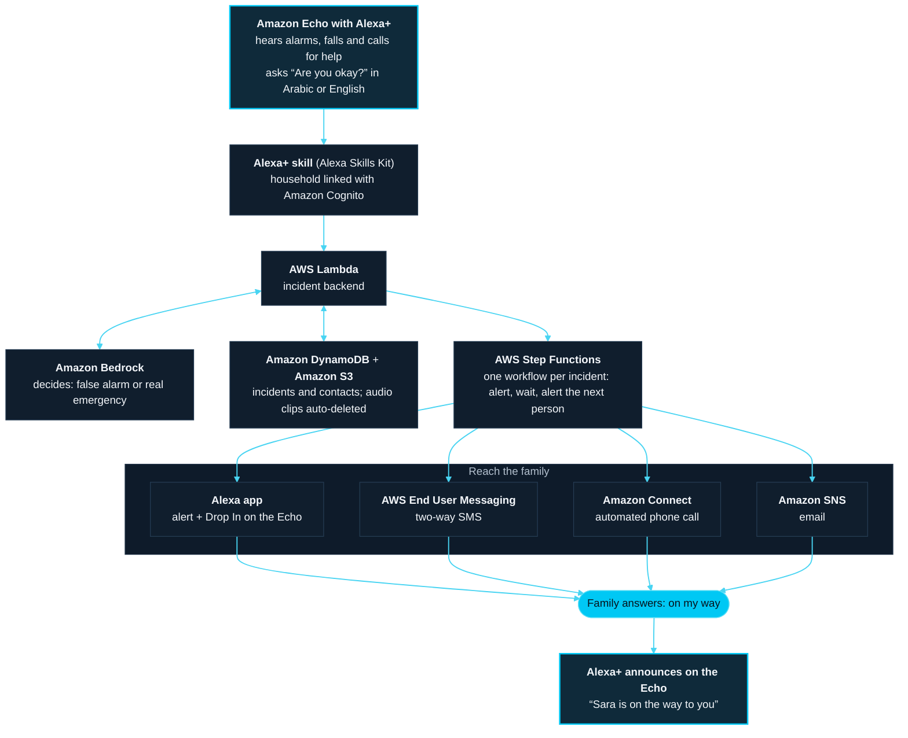

# Home Safety Assistant

A safety assistant for **Alexa+** that keeps an ear on the home. When it hears
a fall, a call for help, a smoke alarm or breaking glass, it asks out loud
**"Are you okay?"**. If the person asks for help, or doesn't answer, it alerts
their family until someone responds, and tells the person at home who is on
the way.

Built for households in Saudi Arabia, in **English and Saudi Arabic**.

This prototype runs in the browser as an Alexa+-style assistant, so it can be
tried without an Echo. [With more time](#with-more-time-on-alexa-and-aws)
shows how it runs on Echo devices with Alexa+ and AWS.

- [What it does](#what-it-does)
- [How to deploy locally](#how-to-deploy-locally) (start here)
- [How it works](#how-it-works)
- [Deploying online](#deploying-online)
- [Project structure](#project-structure)
- [With more time: on Alexa+ and AWS](#with-more-time-on-alexa-and-aws)
- [Team](#team)
- [Known limitations](#known-limitations)

## What it does

| Step                 | What happens                                                                                                                      |
| -------------------- | --------------------------------------------------------------------------------------------------------------------------------- |
| **Listens**          | Detects smoke and gas alarms, falls, calls for help, spoken distress ("my chest hurts", "قلبي يعورني"), breaking glass, screaming |
| **Asks first**       | Says "Are you okay?" and understands the spoken answer. "I'm fine" cancels; "help" or 30 seconds of silence sends the alert       |
| **Filters the TV**   | An optional AI check (Whisper + Claude Haiku 4.5) skips the question only when it is sure nothing is wrong                        |
| **Alerts family**    | Telegram messages with the audio clip and one-tap answers, plus email. Keeps alerting the next person until someone answers       |
| **Closes the loop**  | The answer is spoken at home: "Sara is on the way to you"                                                                         |
| **Tests itself**     | "Test the system" checks the microphone, the voice and the alerts, with messages clearly marked TEST                              |
| **Respects privacy** | No continuous recording. Only a few seconds around an alert leave the device, and they are deleted automatically                  |

The app has two pages:

- **`/`**: the Alexa+-style assistant, with a simulated fall alert.
- **`/monitor`**: the home safety monitor.

## How to deploy locally

The app runs on your own computer **without any accounts or API keys**. Alerts
are printed in the terminal instead of being sent to a phone, and you can
answer them from your browser. Setup takes about five minutes.

### 1. Install the requirements

| You need                   | How to check                     | Where to get it                                                                |
| -------------------------- | -------------------------------- | ------------------------------------------------------------------------------ |
| **Node.js 20.9 or newer**  | `node -v` prints `v20.9` or more | [nodejs.org](https://nodejs.org) (choose the LTS version)                      |
| **pnpm 10**                | `pnpm -v` prints `10.x`          | Run `npm install -g pnpm@10` after installing Node.js                          |
| **Google Chrome**          |                                  | [google.com/chrome](https://www.google.com/chrome) (Microsoft Edge also works) |
| **A microphone**           |                                  | A laptop's built-in microphone is enough                                       |
| **An internet connection** |                                  | Needed for speech recognition and to download the sound model                  |

### 2. Download the code

Either download the ZIP from GitHub (**Code → Download ZIP**) and unzip it, or
run:

```bash
git clone https://github.com/RinDataz/Alexa-hackathon.git
```

Then open a terminal in the project folder:

```bash
cd Alexa-hackathon
```

### 3. Install, set up and start

Run these three commands, one at a time:

```bash
pnpm install
pnpm setup-local
pnpm dev
```

- `pnpm install` downloads the libraries (about a minute).
- `pnpm setup-local` creates the settings file `.env.local` and fills in the
  two secrets a local run needs. It is safe to run again.
- `pnpm dev` starts the app. Wait for **✓ Ready**, and keep this terminal
  open: alerts are printed here.

### 4. Open the monitor

1. In Chrome, go to **http://localhost:3000/monitor**.
   Use `localhost` exactly: the microphone only works on `localhost` or `https://`.
2. Follow the setup screen:
   1. **Language**: English or العربية.
   2. **Watch for**: leave the defaults.
   3. **Alerts**: leave **Balanced**.
   4. **Contacts**: add one contact, for example **Sara**. Leave the email
      empty. The contact will say "not connected" locally; that's expected,
      and alerts are printed in the terminal instead.
   5. **Done**: choose **Start and run a test**.
3. When Chrome asks for the microphone, click **Allow**.

### 5. Try it

**The system test** (runs straight after setup)

1. The monitor asks a practice question. Answer **"I'm fine"**.
2. A TEST alert for Sara is printed in the terminal, with links.
3. Copy one link (for example **On my way**) into a new browser tab, pick
   **Sara** and submit. The monitor says that Sara answered.

**A call for help**

1. Say **"Help me"** (or **"ساعدني"** in Arabic).
2. The monitor asks **"Are you okay?"**. Answer **"Help"**, or stay silent for
   30 seconds.
3. The alert is printed in the terminal. Open its **On my way** link and
   submit.
4. The monitor says **"Sara is on the way to you."**

**A false alarm**

1. Say **"My chest hurts"**.
2. When the monitor asks "Are you okay?", answer **"I'm fine"**. Nothing is
   sent.

**The Alexa+-style assistant**

Go to **http://localhost:3000** to chat with the assistant. Its
**Simulate Fall** button needs the email settings below; without them it
reports that the alert could not be sent.

### 6. Optional: turn on more features

Each feature is switched on by adding keys to `.env.local`. Stop the app with
**Ctrl + C**, edit the file, then run `pnpm dev` again.

| Feature                         | Add to `.env.local`                                                                                    | Works locally?                                                                            |
| ------------------------------- | ------------------------------------------------------------------------------------------------------ | ----------------------------------------------------------------------------------------- |
| AI check (filters TV and radio) | `GROQ_API_KEY`, `ANTHROPIC_API_KEY`                                                                    | Yes                                                                                       |
| Email alerts                    | `AWS_REGION`, `AWS_SNS_TOPIC_ARN`, `AWS_ACCESS_KEY_ID`, `AWS_SECRET_ACCESS_KEY`                        | Yes; answer links open on this computer only                                              |
| Telegram alerts                 | `NOTIFIER_PROVIDER=telegram`, `TELEGRAM_BOT_TOKEN`, `TELEGRAM_BOT_USERNAME`, `TELEGRAM_WEBHOOK_SECRET` | Sending yes; answer buttons need a public URL (see [Deploying online](#deploying-online)) |
| Saved data                      | `STORE_PROVIDER=supabase`, `SUPABASE_URL`, `SUPABASE_SERVICE_ROLE_KEY`                                 | Yes                                                                                       |

Without these, the app uses safe local defaults: rules instead of AI, alerts
in the terminal, and data kept in memory until the app stops. Every variable
is described in [`.env.example`](.env.example).

### Troubleshooting

| Problem                                     | Fix                                                                                                             |
| ------------------------------------------- | --------------------------------------------------------------------------------------------------------------- |
| `pnpm: command not found`                   | Run `npm install -g pnpm@10`, then open a new terminal                                                          |
| `pnpm install` warns about the Node version | Install Node.js 20.9 or newer from [nodejs.org](https://nodejs.org)                                             |
| `Port 3000 is in use`                       | Close the other app using port 3000 (or restart the computer), then run `pnpm dev` again                        |
| The microphone does not start               | Use `http://localhost:3000`, not an IP address. Click the icon left of the address bar and allow the microphone |
| It does not react to speech                 | Use Chrome or Edge, check the internet connection, and check the language chosen in setup                       |
| No alert appears in the terminal            | Check the terminal running `pnpm dev`. Run `pnpm setup-local` again, then restart `pnpm dev`                    |
| Contacts disappeared                        | Local data is kept in memory, so it resets when the app restarts. Add the contact again                         |
| No voice is heard                           | Turn the volume up. If recordings can't play, the browser voice reads the same text                             |

### Checks

```bash
pnpm test        # unit and route tests
pnpm scorecard   # speech accuracy per language
pnpm typecheck
pnpm lint
```

## How it works

```
Browser (/monitor)                              Server (Next.js)
──────────────────                              ────────────────
Microphone ─► 15 s ring buffer
          ├─► YAMNet sound classifier ┐
          └─► Speech recognition      ├─► trigger ─► AI check ──► Groq Whisper
                                      │              (speech)     Claude Haiku 4.5
                                      ▼
                          "Are you okay?" (spoken) ─► incident recorded ─► Supabase
                                      │
                       fine ◄─────────┴────────► help / no answer
                     (cancel)                         │
                                                      ▼
                                   escalation runner (every 15–30 s)
                                       ├─► Telegram: audio + reply buttons
                                       └─► Email (AWS SNS): answer link
                                                      │
                     spoken at home ◄── contact answers (On my way / Calling)
```

- Sound classification runs entirely in the browser.
- Each external service sits behind a small interface in
  `lib/server/providers/`, with a local fallback, which is why the app runs
  without any keys.
- Escalation runs on the server, so alerts continue even if the monitor tab
  closes.
- **Escalation order:** critical incidents alert everyone at once. Others
  alert contacts one by one, then everyone.

**Tech stack:**

- **App:** Next.js 16, React 19, TypeScript, Tailwind CSS
- **Listening:** MediaPipe Audio (YAMNet), Web Speech API
- **AI:** Groq Whisper, Anthropic Claude Haiku 4.5
- **Alerts:** Telegram Bot API, AWS SNS
- **Data:** Supabase (Postgres, Storage, pg_cron, pg_net, Vault)
- **Tooling:** Zod, Vitest

## Deploying online

1. **Supabase**: run [`db/schema.sql`](db/schema.sql), enable `pg_cron` and
   `pg_net`, add the Vault secrets `cron_secret` and `app_base_url`, then run
   [`db/schedule.sql`](db/schedule.sql).
2. **Vercel**: import the repository, set the variables from
   [`.env.example`](.env.example), and deploy.
3. **Telegram**: register the webhook
   `https://<your-app>/api/telegram/webhook` with `TELEGRAM_WEBHOOK_SECRET` as
   the secret token.
4. **Check**: open `https://<your-app>/health` to confirm every variable is
   set and well formed, then open `/monitor` and run **Test the system**.

Step-by-step instructions are in
[`docs/safety-assistant.md`](docs/safety-assistant.md).

## Project structure

| Path                                | Contents                                                                      |
| ----------------------------------- | ----------------------------------------------------------------------------- |
| `app/monitor`, `components/safety/` | Monitor screen, setup, contacts, confirmation prompt, system test             |
| `hooks/use-safety-monitor.ts`       | Ties capture, detection, speech and escalation together                       |
| `lib/safety/`                       | Shared rules: incidents, matching, replies, escalation policy, retention      |
| `lib/safety/languages/`             | One file per language: phrases, questions, spoken lines and test sentences    |
| `lib/audio/`                        | Microphone, ring buffer, YAMNet, impact detector, speech in and out           |
| `lib/server/`                       | Escalation runner, alert texts, signed links, configuration checks, providers |
| `app/api/`                          | API routes                                                                    |
| `db/`                               | Supabase schema and scheduler                                                 |
| `components/alexa/`, `lib/aws/`     | The Alexa+-style assistant and the email layer                                |

To add a language, copy a file in `lib/safety/languages/`, translate it, and
register it in `lib/safety/languages/index.ts`. `pnpm scorecard` then reports
its accuracy. The UI uses [shadcn/ui](https://ui.shadcn.com) components in
`components/ui`.

## With more time: on Alexa+ and AWS

Alexa+ is the heart of the idea: the Echo already in the living room becomes
the safety assistant. It listens, asks "Are you okay?" in a natural
conversation, and tells the person at home who is coming. Everything behind
it runs on AWS, in the regions closest to Saudi Arabia wherever each service
is available.



If the diagram doesn't display, see
[`docs/images/aws-architecture.png`](docs/images/aws-architecture.png).

| Part                   | This prototype                       | On Alexa+ and AWS                                                   | What it adds                                                            |
| ---------------------- | ------------------------------------ | ------------------------------------------------------------------- | ----------------------------------------------------------------------- |
| Listening device       | A Chrome tab                         | Amazon Echo with Alexa+                                             | Runs all day on a device families already own, with no tab to keep open |
| Conversation           | Browser speech recognition and voice | Alexa+                                                              | Natural conversation and Alexa's own voice, in Arabic and English       |
| Sign-in                | None                                 | Alexa+ skill with account linking (Amazon Cognito)                  | Only the household's own Echo devices and family can use it             |
| Backend                | Next.js routes on Vercel             | AWS Lambda                                                          | Scales on demand, with no servers to manage                             |
| AI check               | Groq Whisper + Anthropic API         | Amazon Bedrock (Claude Haiku)                                       | Same model, billed and secured with the rest of the account             |
| Escalation             | pg_cron every 30 s                   | AWS Step Functions                                                  | One visible workflow per incident; a reply stops it immediately         |
| Offline warning        | pg_cron heartbeat check              | Amazon EventBridge Scheduler                                        | Warns the family if the Echo goes offline                               |
| Data                   | Supabase Postgres and Storage        | Amazon DynamoDB + Amazon S3                                         | Automatic deletion (DynamoDB TTL, S3 lifecycle) and AWS KMS encryption  |
| Alerts                 | Telegram + Amazon SNS email          | Alexa app, AWS End User Messaging (SMS), Amazon Connect, Amazon SNS | Family can Drop In on the Echo to talk, or answer by SMS or phone call  |
| Answer heard at home   | Recorded voice prompts               | Alexa+ announcement on the Echo                                     | "Sara is on the way to you" in Alexa's voice                            |
| Secrets and monitoring | Vercel variables and logs            | AWS Secrets Manager + Amazon CloudWatch                             | Keys rotated in one place, and an alarm if an alert fails to send       |

## Team

- **Fahad Aljudaibi**: Alexa+-style assistant app
- **Faris Abushanab**: email alerts with AWS SNS
- **Rinad Almjishai**: home safety monitor and AI layer

## Known limitations

- **Silent falls:** a fall with no impact sound or speech can't be detected
  from audio.
- **Speech goes to Google:** Chrome sends audio to Google while recognising
  speech. The app itself stores only the short clips around alerts.
- **The tab must stay open:** the monitor tab has to stay open on a device
  that is plugged in. If it stops, contacts are warned.
- **No automatic emergency call:** messages tell people to call 911 (997
  ambulance, 998 civil defence).
- **One household per deployment.**
- **No sign-in:** anyone with the link can open the monitor. Email addresses
  are shown masked. Once a contact joins on Telegram, their invite link is no
  longer shown and no one else can use it.
